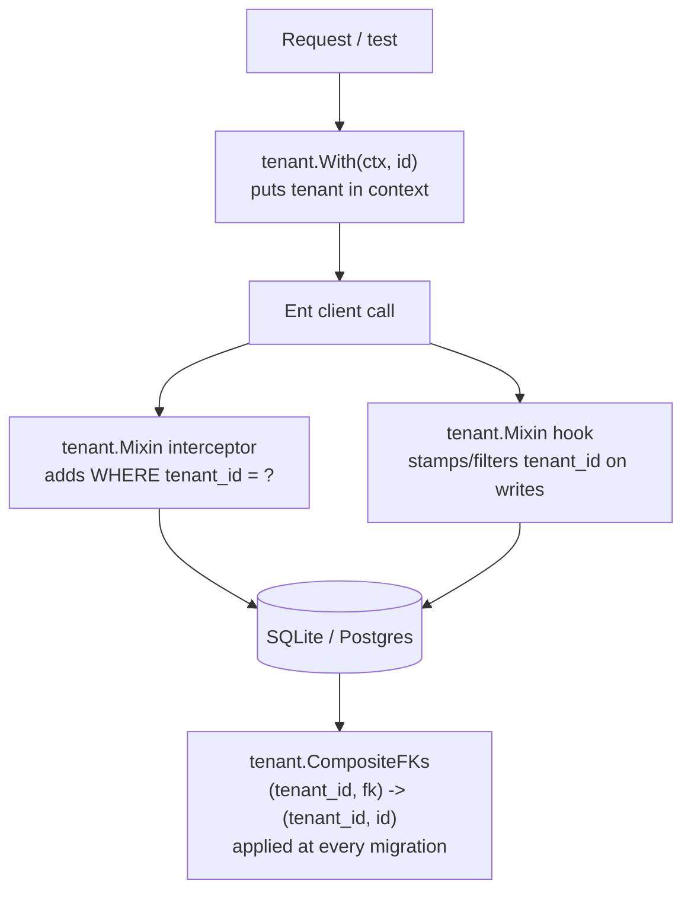

# Repository Guidelines

## Project Overview

swago is a Go-native CMS inspired by Wagtail (Django), module `github.com/seun-otosho/swago`, Apache-2.0. **As of 2026-10-23 the repo holds the foundation layer only**: tenant scoping, the core `Page` entity, materialized-path helpers, a DB opener, and a dogfood example project — no page-tree service, routing, templ rendering, admin UI, or CLI yet.

The goal is explicitly a **rethink, not a port**: no Wagtail API/DB compatibility is promised. Page types are Go structs checked at compile time (not Python runtime metaclasses); extensions are compiled-in Go interfaces (not monkey-patched hooks); the admin will be server-rendered templ + htmx (not a Draftail SPA). Deployment target is a single cgo-free binary.

`docs/DESIGN.md` is the source of truth for every architectural decision and its rationale (including three completed spikes); `docs/FEATURE_MAP.md` tracks Wagtail-feature parity status and the build order. Read `DESIGN.md` before touching schema, tenancy, or migration code — it documents *why*, this file documents *where* and *how*.

## Architecture & Data Flow



- **Core vs. project split**: core (this repo's root packages) exposes plain `ent.Schema` types and mixins; a project — `examples/site/` is the reference one — re-exposes each core entity by **embedding** it in its own `ent/schema` package, e.g. `type Page struct{ schema.Page }` (`examples/site/ent/schema/page.go`). Ent's loader carries the embedded `Fields`/`Edges`/`Mixin`/interceptors/hooks through, so the generated client ends up with core and project entities together in one package. This is Spike 1/2's result (see `DESIGN.md` "Install, scaffold and extend").
- **Tenant scoping is the central cross-cutting pattern** (`tenant/tenant.go`, `tenant/fk.go`) — layered defense, each layer catching what the one before misses:
  1. `tenant.Mixin` interceptor adds `WHERE tenant_id = ?` from `tenant.From(ctx)`; fails closed with `tenant.ErrNoTenant` if the context carries no tenant and no `tenant.AllowWithoutTenant(ctx)` escape hatch.
  2. `tenant.Mixin` hook stamps `tenant_id` on create, rejects a create carrying a different tenant, and filters update/delete the same way — a guessed foreign ID from another tenant matches zero rows.
  3. `tenant.CompositeFKs` (an Ent `schema.WithDiffHook`) rewrites every single-column FK between tenant-bearing tables into `(tenant_id, fk) -> (tenant_id, id)` at the database level, so a row literally cannot reference another tenant's row. **Must be passed to every `Schema.Create`/`Schema.Diff` call** — see `examples/site/site.go`.
  4. Because Ent only exposes `WhereP` through each project's generated `intercept` package, core cannot call it directly: core exposes `tenant.QueryAdapter` (a `func(ent.Query) (tenant.Wherer, error)`), and every project wires it once in `init()`: `tenant.QueryAdapter = func(q ent.Query) (tenant.Wherer, error) { return intercept.NewQuery(q) }` (`examples/site/site.go`). Without this the interceptor refuses to run — fails closed, not silently open.
- **Page tree**: pure, DB-free, base-36 materialized paths in `tree/path.go` (`Step`, `Parent`, `FirstChild`, `NextSibling`, `Rebase`, `Depth`) — 4 chars/level, so a node has at most 36⁴-1 children. The core `schema.Page` entity stores `path`/`depth`/`numchild`/`url_path` but the tree-mutation service (add/move/copy in one transaction) is not built yet.
- **Page field storage** (decided 2026-10-22, DESIGN.md "Open questions"): three-way split, all via Ent/Atlas:
  1. **Pages (default)**: one base `pages` entity (tree, URL, publish state, `tenant_id`) plus a JSON `data` column for page-type fields — no per-type migrations.
  2. **Typed extension (opt-in)**: a page type needing queryable fields gets its own entity linked to the base page by composition (Ent has no inheritance) — e.g. `examples/site/ent/schema/article.go`'s `Article` has a required unique edge to `Page`.
  3. **Application records**: non-page data at scale (orders, products, etc.) are plain Ent entities with real columns, carrying the tenant mixin, registered through a future model-registration interface — not page types, not JSON.
- **Migrations**: Ent auto-migration (`client.Schema.Create`, dev) vs. Atlas versioned SQL (`client.Schema.Diff` with codegen feature `sql/versioned-migration`, production) — both always take `tenant.CompositeFKs`. Spike 3 proved versioned migrations work without the separate Atlas CLI. Ent does not detect renames (looks like drop+add) — fix by hand with `StorageKey` or a `schema.WithDiffHook`.
- **No many-to-many edges in core** (Spike 2 finding): they create a join table with no `tenant_id`, defeating the mixin. Use a through-entity carrying `tenant.Mixin` instead.
- **Templates/admin/blocks**: templ + htmx, StreamField-style block JSON — decided in DESIGN.md but not yet implemented; no `templates/`, `blocks/`, or admin code exists in this repo yet.
- **Build order** (DESIGN.md "Build order"): foundations (done: tenant mixin, core `Page`, tree helpers, DB opener, migrations) → page tree service, typed page models, sites/routing → blocks + revisions/draft-publish → headless API + templ rendering → auth/permissions → admin UI → images/documents/search/i18n/workflows.

## Key Directories

| Path | Purpose |
| --- | --- |
| `tenant/` | `tenant.go` (context scoping, Ent mixin/interceptor/hook, `QueryAdapter`), `fk.go` (`CompositeFKs` diff hook) |
| `schema/` | Core Ent schemas projects embed — currently `page.go` (base `Page` entity) |
| `tree/` | Pure materialized-path math (`path.go`) + its unit tests, no DB dependency |
| `db/` | `db.Open(url)` — dialect-detecting opener for `sqlite://` / `postgres://` URLs, wraps the pure-Go `modernc.org/sqlite` and `pgx` drivers for Ent |
| `examples/site/` | The reference scaffolded project ("the shape `swago new` scaffolds"): `site.go` (client `Open`, `QueryAdapter` wiring), `site_test.go` (canonical tenant/migration test suite), `ent/schema/` (project entities: `page.go`, `article.go`), `ent/` (generated Ent client — **do not hand-edit**, regenerate with `go generate`) |
| `docs/` | `DESIGN.md` (decisions + rationale + spike results), `FEATURE_MAP.md` (Wagtail parity tracker + build order) |
| `.github/workflows/` | `ci.yml` — generated-code-is-current check, `go vet`, `go test` against SQLite + a Postgres 17 service container |

Directories named in DESIGN.md's scaffold ("Install, scaffold and extend") but **not yet built**: `pages/`, `blocks/`, `templates/`, `migrations/`, a `swago` CLI (`swago new`/`serve`/`migrate`/`generate`/`createsuperuser`) — don't assume these exist.

## Development Commands

```sh
go build ./...                          # compile everything
go vet ./...                            # CI runs this
go test ./...                           # SQLite-only by default
SWAGO_TEST_POSTGRES=postgres://swago@localhost:5432/ go test ./...   # also runs Postgres backend
cd examples/site/ent && go generate .   # regenerate Ent client after schema changes
```

`SWAGO_TEST_POSTGRES` must be a server URL ending in `/`; the tests expect two pre-existing empty databases named `swago_test` and `swago_dev` on that server (CI creates them via `.github/workflows/ci.yml`). Without the env var, Postgres subtests are skipped and only SQLite runs.

No `swago` CLI, `Makefile`, or linter config exists yet — build/test/vet above are the only tooling currently wired up. `golangci-lint` with a `forbidigo` rule (banning raw SQL driver access outside `tenant`/migration packages) is a documented intent in DESIGN.md, not yet configured.

## Code Conventions & Common Patterns

- **Core exports plain `ent.Schema`/mixin types; projects embed, never duplicate.** Adding a core entity: write it in a root-level package (like `schema/page.go`), then every project re-declares it one line at a time in its own `ent/schema` (`type X struct{ schema.X }`). There is no automatic sync yet — a future `swago new`/`swago generate` is meant to write/maintain those embedding lines (Spike 1 finding).
- **Every tenant-bearing entity mixes in `tenant.Mixin{}`** and must pass `tenant.CompositeFKs` to its `Schema.Create`/`Schema.Diff` call (see `examples/site/site.go`'s `Open`). Skipping either silently reopens the cross-tenant leak the whole design exists to close.
- **A project must wire `tenant.QueryAdapter` in `init()`** before opening any client, pointing at its own generated `intercept.NewQuery`. This is per-project boilerplate, not something core can do for you.
- **Pure Go only** in core: `modernc.org/sqlite` not `mattn/go-sqlite3` (no cgo, keeps single-binary cross-compiling simple) — apply the same bias to future work (e.g. image rendering: pure-Go `imaging` over cgo `govips`).
- **DB URLs are scheme-prefixed** (`sqlite://...`, `postgres://...`/`postgresql://...`); `db.Open` dispatches on the prefix and `redact()` strips credentials from any error message — follow this pattern for new backends rather than branching on driver name elsewhere.
- **Tree math stays pure**: `tree/path.go` has no DB or Ent dependency — path encode/decode/rebase logic is unit-testable in isolation (`tree/path_test.go`) and should stay that way as the tree-mutation service is built on top of it.
- **Migrations are expand-and-contract**: add column → backfill/dual-write → switch reads → drop column in a later release. Never a single destructive step; Atlas lint flags drops/type-narrowing for explicit review.
- **No many-to-many Ent edges in core** — use a through-entity with `tenant.Mixin{}` so the join table itself is tenant-scoped.

## Important Files

| File | Role |
| --- | --- |
| `docs/DESIGN.md` | All architectural decisions, rationale, and spike 1–3 results (Ent/core-embedding, tenant mixin, cross-tenant FKs + versioned migrations). Read first for *why*. |
| `docs/FEATURE_MAP.md` | Wagtail→Go feature-by-feature status (Designed/Named/Not covered) and the authoritative build order. |
| `schema/page.go` | Core `Page` entity: `path`, `depth`, `numchild`, `title`, `slug`, `url_path`, `type`, JSON `data`; unique `(tenant_id, path)` index. |
| `tenant/tenant.go` | `With`/`From`/`AllowWithoutTenant` context helpers, `tenant.Mixin` (fields+interceptor+hook), `QueryAdapter` extension point, `ErrNoTenant`. |
| `tenant/fk.go` | `CompositeFKs` — the Atlas diff hook enforcing composite tenant-aware foreign keys at the schema level. |
| `tree/path.go` | Materialized-path encode/decode/rebase (base-36, 4-char steps). |
| `db/db.go` | `Open(url)` — the only place driver selection and DSN pragma defaults live. |
| `examples/site/site.go` | Canonical "how a project opens a client" pattern: `QueryAdapter` wiring in `init()`, `Open()` calling `Schema.Create` with `tenant.AllowWithoutTenant` + `tenant.CompositeFKs`. |
| `examples/site/site_test.go` | Canonical test suite shape for any new entity: `TestTenantIsolation`, `TestCrossTenantReference`, `TestEveryTableHasTenantID` (self-discovering), `TestVersionedMigrations`. Copy this pattern, don't invent a new one. |
| `examples/site/ent/schema/*.go` | Reference project schema: `page.go` (embeds core `Page`), `article.go` (opt-in typed extension pattern — own entity + required unique edge to `Page`). |
| `.github/workflows/ci.yml` | CI contract: generated code must be current (`go generate` + `git diff --exit-code`), `go vet`, `go test` with a live Postgres 17 service. |

## Runtime/Tooling Preferences

- **Go 1.26.4** pinned in `go.mod` (`go.mod` line 3) — DESIGN.md says "1.25 or later", the committed module pins the exact version actually in use.
- **ORM/query layer**: Ent v0.14.6 (`entgo.io/ent`) — schemas are Go code, codegen produces typed queries. Chosen 2026-10-22 over an earlier GORM decision.
- **SQL drivers**: `modernc.org/sqlite` (pure Go, no cgo) for SQLite; `github.com/jackc/pgx/v5` for Postgres.
- **Migrations**: `ariga.io/atlas` integrated through Ent's `sql/versioned-migration` codegen feature — no separate Atlas CLI install required for the versioned-migration path (Spike 3).
- **Module path**: `github.com/seun-otosho/swago`. **License**: Apache-2.0 (patent grant, open to outside contributors — decided 2026-10-22).
- **Templates/admin**: templ + htmx are the decided choice for when that work starts — neither dependency is in `go.mod` yet because no template/admin code exists.
- **Databases**: SQLite (default) and Postgres ship first; MySQL/MariaDB is deferred (DESIGN.md).

## Testing & QA

- Run everything: `go test ./...`; add `SWAGO_TEST_POSTGRES=postgres://user@host:port/` to also exercise the Postgres backend (two empty DBs, `swago_test` and `swago_dev`, must already exist on that server).
- `examples/site/site_test.go` is the reference suite for any new tenant-bearing entity — model new tests on its four functions rather than writing ad hoc assertions:
  - `TestTenantIsolation` — create/list/get/update/delete never cross tenant boundaries; a no-tenant context fails with `tenant.ErrNoTenant`; `tenant.AllowWithoutTenant` sees everything.
  - `TestCrossTenantReference` — the database itself (via `tenant.CompositeFKs`) refuses a row pointing at another tenant's row, even bypassing the application layer.
  - `TestEveryTableHasTenantID` — self-discovering: walks `migrate.Tables`, so a new entity without the tenant mixin fails here automatically, with no test changes required. **Never hand-maintain a list of models for this check.**
  - `TestVersionedMigrations` — generates Atlas SQL from an empty dev DB, applies it to a fresh DB, re-diffs against the directory; the Ent schema and migration files must agree (this is the CI drift check, done in-process).
- `tree/path_test.go` is a plain table-of-assertions unit test for the pure path math — follow that style (no framework, `t.Helper()` + `t.Fatalf`) for other DB-free packages.
- CI (`.github/workflows/ci.yml`) additionally requires generated Ent code to be up to date: it runs `go generate` in `examples/site/ent` and fails on any resulting diff — regenerate locally after any schema change, don't hand-edit files under `examples/site/ent/` (everything there except `ent/schema/` is generated).
- Every new tenant-bearing schema must be exercised by the leak test (automatic via `TestEveryTableHasTenantID`) and should get its own `TestTenantIsolation`-style coverage if it introduces new edges or unique constraints.
