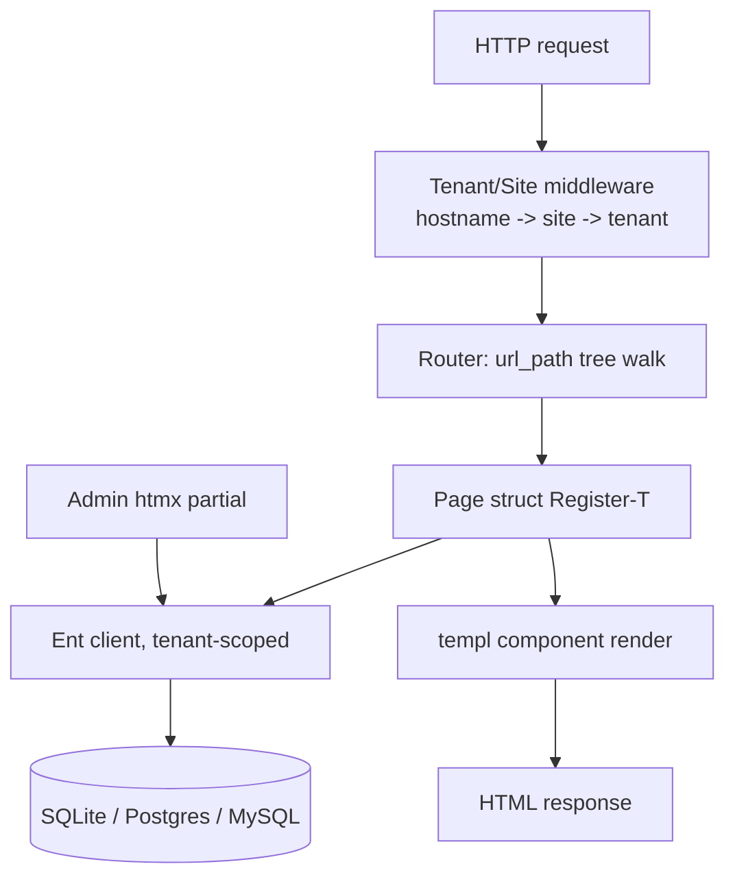

# Repository Guidelines

## Project Overview

swago is a planned Go-native CMS inspired by Wagtail (Django). **As of 2026-10-22 this repo contains no code** — only two planning documents (`docs/DESIGN.md`, `docs/FEATURE_MAP.md`) and a single `init` commit plus design-doc commits on `main`. There is no `go.mod`, no source tree, no tests, no build config, no CLI binary yet.

The goal is explicitly a **rethink, not a port**: no Wagtail API/DB compatibility is promised. Page types are Go structs checked at compile time (not Python runtime metaclasses); extensions are compiled-in Go interfaces (not monkey-patched hooks); the admin is server-rendered templ + htmx (not a Draftail SPA). Deployment target is a single static binary.

Because there is no code yet, this file documents the **decided architecture and conventions from DESIGN.md** that any code added to this repo must follow, plus the still-open decisions to watch for.

## Architecture & Data Flow



- **Query layer: Ent** (decided 2026-10-22, replacing an earlier GORM decision). Schemas are Go code in `ent/schema/`; queries are generated and typed. Pure-Go `modernc.org/sqlite` driver — no cgo, keeps the single-binary goal.
- **Page tree**: materialized paths (`path`, `depth`, `numchild`), like treebeard — chosen because it works identically across all three supported databases.
- **Multi-tenancy is first-class**, not retrofitted: every content-bearing table (pages, snippets, redirects, revisions, workflows, collections, users, groups) carries `tenant_id` via a shared Ent mixin. Enforcement is layered (see "Tenant scoping" below) — this is the single most important cross-cutting pattern in the design and must not be bypassed ad hoc.
- **Migrations**: Ent auto-migration (`client.Schema.Create`) in dev; Atlas-generated versioned SQL in production (`atlas migrate apply`). Ent does not detect renames — a rename looks like drop+add and must be fixed by hand (`StorageKey` or `schema.WithDiffHook`) before committing a migration.
- **Templates/admin**: templ for all templates, htmx for the whole framework including admin, small JS islands only where unavoidable (rich text editor, drag-and-drop reorder in StreamField blocks).
- **Blocks (StreamField equivalent)**: same `{type, id, value}` JSON shape as Wagtail on disk, but each block is a Go type in a tagged-union-style registry with a `Render() templ.Component` method.
- **Build order** (DESIGN.md "Build order", refined in FEATURE_MAP.md "Suggested build order"): foundations (Ent+SQLite+tenant mixin+Atlas) → page tree/sites/routing → templ rendering → blocks/rich text/revisions → auth/permissions → htmx admin → media/snippets → headless API/search → publishing extras → workflows/i18n/forms/importer.

## Key Directories

**None exist yet.** The scaffold a `swago new mysite` CLI command will eventually produce (per DESIGN.md "Install, scaffold and extend") is the intended shape for *downstream* projects, and should guide how the core library itself is laid out:

| Planned path | Purpose |
| --- | --- |
| `pages/` | Project's page types (Go structs implementing `Page`) |
| `blocks/` | StreamField block type definitions |
| `ent/schema/` | Ent entity schemas, composing core mixins + base page entity |
| `templates/` | templ components |
| `migrations/` | Single Atlas migration directory (core + project schemas share ordering) |
| `examples/` | Dogfooding project built from the scaffold template; CI builds and runs it |
| `docs/` | Design docs (current sole content: `DESIGN.md`, `FEATURE_MAP.md`) |

## Development Commands

No build/test/lint tooling exists yet (no `go.mod`, no `Makefile`, no CI config). Per DESIGN.md, the eventual `main.go` for a scaffolded project is intentionally tiny:

```go
swago.New(cfg).Register(pages.Home{}, pages.Article{}).Run()
```

`Run()` is designed to provide these subcommands (not yet implemented):

| Command | Purpose |
| --- | --- |
| `swago new mysite` | Scaffold a new project (Go module, pages/blocks/ent/templates/migrations/config) |
| `swago serve` | Run the HTTP server |
| `swago migrate` | Apply migrations (Ent auto-migrate in dev, Atlas in prod) |
| `swago migrate generate` | Diff Ent schema, write Atlas migration files (also used on `swago` library upgrades) |
| `swago generate` | Run Ent codegen |
| `swago createsuperuser` | Bootstrap an admin user |

When a `go.mod` is added, set Go **1.25 or later** (DESIGN.md recommendation, not yet pinned).

## Code Conventions & Common Patterns

These are binding conventions from DESIGN.md — follow them once code is added, don't introduce a second convention:

- **Pure Go in core unless there's a strong reason.** `modernc.org/sqlite` not `mattn/go-sqlite3`; this keeps cross-compiling a cgo-free single binary possible. Apply the same bias to future image-rendition work (pure-Go `imaging` vs cgo `govips`).
- **Tenant scoping is mandatory on every table/query touching content.** Layered defense, each catching what the previous misses:
  1. Ent **interceptor** adds `WHERE tenant_id = ?` from request context; **privacy policy** denies ops with no tenant in context. Escaping requires an explicit, greppable "allow without tenant" helper, used only by system jobs/superusers.
  2. Ent **mutation hook** (shared mixin) stamps `tenant_id` from context on write, rejects mismatched tenant.
  3. **Composite keys/unique indexes** are `(tenant_id, ...)` — e.g. `(tenant_id, parent_path, slug)` — and foreign keys are `(tenant_id, id)` composites.
  4. **`golangci-lint forbidigo`** bans direct SQL driver access outside the `tenant` and migration packages.
  5. Caches/search/file storage keys are tenant-prefixed (`tenant/<id>/media/...`).
  6. A **leak test** iterates every registered model, creates rows for two tenants, asserts cross-tenant isolation on list/get/update/delete — must auto-pick-up new models via self-registration, never hand-maintained.
- **Extension points are explicit Go interfaces, compiled in** — no runtime plugin loading, no monkey-patching. `Page`, `Block`, snippets, settings, middleware, admin hooks (menu items, views, choosers) are all registered in code via something like `Register[T]()`.
- **Migrations follow expand-and-contract**: (1) add new column, (2) backfill + dual-write, (3) switch reads, (4) drop old column in a later release. Never a single destructive step.
- **Schema/migration drift is a CI failure**: after applying all migrations to an empty DB, `atlas schema diff` against the Ent schema must be empty.
- **Backfills are tenant-scoped and batched** — run per tenant explicitly, never cross-tenant.
- **No Postgres-only features in core** (no ltree, no JSONB operators) — block JSON is TEXT/JSON so it works identically across SQLite/Postgres/MySQL.
- **Rich text**: store HTML with Wagtail-style link references (`<a linktype="page" id="3">`), resolved at render time, sanitized with `bluemonday` — not editor-native JSON (ProseMirror/Lexical), for readability and importability.

## Important Files

| File | Role |
| --- | --- |
| `docs/DESIGN.md` | Primary architecture decisions, rationale, open questions, review notes. Read this before any schema/architecture work. |
| `docs/FEATURE_MAP.md` | Wagtail-to-Go feature parity tracker with Designed/Named/Not-covered status per feature; also holds the authoritative build order. |

No `main.go`, `go.mod`, config files, or entry points exist yet — these are the first artifacts `swago new` (once built) or manual scaffolding will produce.

## Runtime/Tooling Preferences

- **Language**: Go (version to be pinned at 1.25+ when `go.mod` is created).
- **ORM/query layer**: Ent (ent.dev) — chosen 2026-10-22 over an earlier GORM decision. Verify exact dialect/version support against Ent's dialect docs before committing to a Go/DB version pairing.
- **SQL driver**: `modernc.org/sqlite` (pure Go, no cgo) — required for the single-binary, cross-compile goal.
- **Migration tool**: Atlas (ariga.io/atlas), integrated via Ent, generating versioned SQL reviewed and applied with `atlas migrate apply`. Not goose, not hand-written SQL.
- **Templates**: templ (not `html/template`).
- **Frontend/admin interactivity**: htmx, with small JS islands only for rich text editing and StreamField drag-and-drop/reorder — not a full SPA.
- **Databases supported**: SQLite (default, dev + zero-ops), Postgres, MySQL/MariaDB (parity with Django/Wagtail's supported backends).
- **Lint**: golangci-lint with the `forbidigo` rule configured to ban raw SQL driver access outside `tenant`/migration packages (not yet configured — `.golangci.yml` doesn't exist yet).

## Testing & QA

No test harness exists yet. DESIGN.md specifies the required strategy once code lands:

- **Test matrix**: every migration and the full suite must run against all three supported databases (SQLite, Postgres, MySQL) in CI; CI matrix across dialects is explicitly called for, not optional.
- **Tenant leak test is non-negotiable**: a dedicated test that iterates every registered model, creates two tenants' worth of rows, and asserts zero cross-tenant visibility on list/get/update/delete. New models must be covered automatically via self-registration — this test must never need manual updates per model.
- **Migration CI guard**: applying all migrations to an empty DB, then running `atlas schema diff` against the live Ent schema, must produce an empty diff — a schema change without a generated migration fails CI.
- **Destructive migration guard**: Atlas lint flags destructive steps (drops, type narrowing); these require an explicit approval comment in the migration file.
- **Dogfooding**: the repo is meant to keep an `examples/` project built from the same scaffold template that CI builds and runs, so every core feature is exercised from a real scaffolded project, not just unit tests.
- No test framework (standard `testing` vs testify vs something else) has been chosen yet — this is an open gap noted in DESIGN.md's review section (point 12: "a testing strategy" is listed as not mentioned at all).
